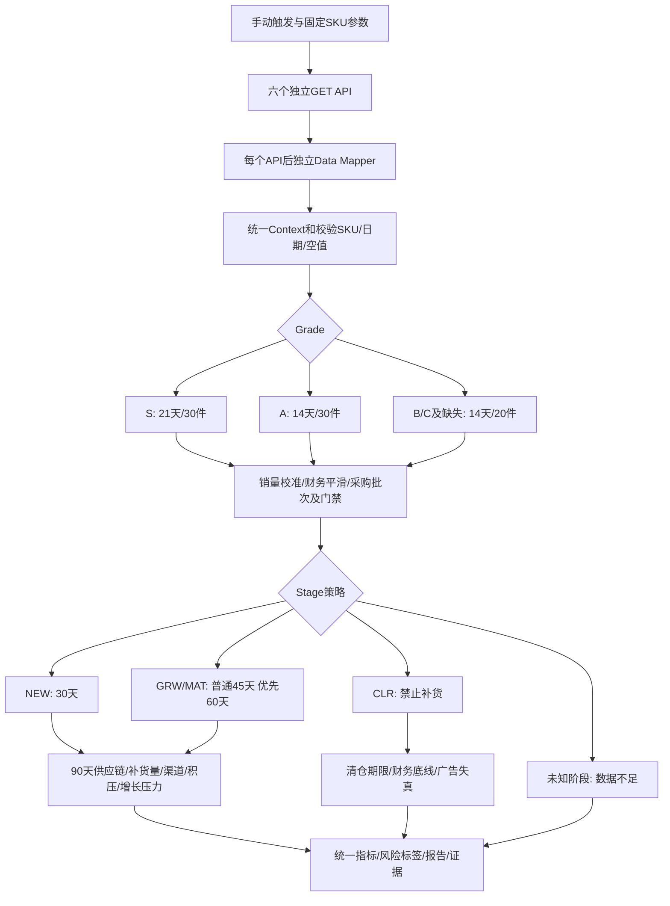

# 单SKU库存诊断与健康度工作流

[打开 Activepieces 草稿](https://flow.eshop.evexport.cn/projects/D39taW24AEQ4mNoeEO8IE/flows/Qh7au61yzigFaAdkxK8SX)

固定 SKU：`JJ005-6`。入口为 Manual Trigger，当前保留为未发布、停用的草稿。
在编辑器点击 **Test Flow**，完成后查看 `step_40` 的 `metrics`、`markdown`、`alerts` 和 `evidence`。
后续需要使用 Run Flow 时再发布启用；本版本没有定时器。

所有 ERP 请求都是 GET，仅输出分析结果，不保存诊断事件，不触发平台同步、采购或消息发送。
鉴权直接引用已有项目变量 `{{variables['YUANLONG_TOKEN']}}`，文件与测试样本不包含密钥。

## 执行顺序



41个节点中，HTTP、字段提取和分支参数采用内置组件；复杂判断拆成14个小代码模块，每个模块只处理一种职责。
Grade、Stage 和诊断类型各使用独立 Router，不把整套规则隐藏在单个代码节点中。

## 调整入口

| 需要调整的内容 | Activepieces 节点 | 本地文件 |
| --- | --- | --- |
| SKU、ERP地址、90天提前期、30/45/60天目标、批量容差 | step_1 | flow-definition.json 中对应节点 |
| 基础字段与元数据 | step_3 | flow-definition.json 中 Mapping |
| 库存字段路径、严格预测、历史周 | step_5 | flow-definition.json 中 Mapping |
| Grade/Stage、生命周期事件与起点路径 | step_7 | flow-definition.json 中 Mapping |
| 利润周数组、漏斗周与Listing、分仓数据路径 | step_9 / step_11 / step_13 | flow-definition.json 中 Mapping |
| Grade阈值 | step_15 至 step_20 | Grade分支中的Data Mapper |
| 日销校准 | step_21 | calibrate_velocity.mjs |
| 三周财务平滑 | step_22 | smooth_finance.mjs |
| 在途批次、保护门禁、CLR起点 | step_23 | events_and_gates.mjs |
| Stage策略 | step_24 至 step_30 | Stage分支中的Data Mapper |
| 90天供给与即期断档 | step_32 | supply_risk.mjs |
| 目标库存与批量规整 | step_33 | replenishment.mjs |
| 官方仓/FBS与Top5集群缺口 | step_34 | channel_health.mjs |
| 积压门禁与渠道休眠 | step_35 | overstock.mjs |
| S/A新品成长期增长30% | step_36 | growth_stress.mjs |
| CLR期限及财务 | step_37 / step_38 | clearance_schedule.mjs / clearance_finance.mjs |
| 最终字段、风险排序、Markdown | step_40 | report.mjs |

当前文件是已部署草稿的源码快照。修改本地 `.mjs` 后，需要用 `ap_update_step` 更新对应节点的 `sourceCode`，再运行完整流程测试。
`flow-definition.json` 保存所有节点的实际设置及父子关系，便于核对和恢复；它不是 Activepieces UI 的原生导入包。

## 取值与业务约束

- 基准日期唯一来源是 `data.period.as_of`，不读取模型或JavaScript运行时的当前日期。上下文采用API用户配置的 `Europe/Moscow` 时区，全部接口须一致。
- 利润默认P0是上一个完整自然周；漏斗默认P0是本周。保留各自周期，不把两个P0强行对齐，不把每个七天周期当成四周汇总。
- 库存、日销和覆盖天数优先使用上下文指标。断货校准命中时，全链覆盖按 `(book_stock + incoming_quantity) / v_effective` 重算；在库覆盖天数仍按原规则直接引用上下文。
- 空值、缺失字段及明确不在 `available_metrics` 中的指标保留为缺失。缺少必要指标时输出 `insufficient_data`，不输出假零或绿色健康结论。
- 近7天采购入库或近14天恢复库存，以及按Grade定义的低库存/低周转，触发日销校准。历史样本从最新向前跳过缺失或低库存周，最多取3个正常有货周。
- 财务平滑按P0/P-1/P-2的销量加权；任一必要周指标缺失时，不把该周补为0。
- 全链覆盖达到90天时建议补货量为0。低于90天时，NEW按30天；GRW/MAT普通按45天，S/A或P0年化回报>80%按60天。低回报或亏损保留具体建议量，同时要求下单前核实收益。
- 先按目标天数乘有效日销。接近最近采购批量的整数倍时，以10%容差规整；否则向上取整。NEW不因批量规整增加测款资金占用。交期内损失销量不重复计入订货量。
- 在库不足7天或库存不足10件、近14天入库/本周库存增加超过100件时，积压预警静音。
- FBS代表白俄本地仓履约，不能推断平台仓储费；只有平台官方仓的现货检查平台仓储风险。多个Listing可能挂载同一物理库存，禁止相加后从book_stock扣除；未铺发库存暂输出null并说明限制。
- 本周末漏斗库存可能为null。渠道检查优先采用分仓接口当前的官方仓/FBS库存，并保留来源。WB缺少有效分布缺口时，不编造集群补货量。
- CLR独立检查固定90天清仓期限、停滞、损益与广告失真，禁止生成补货预警和采购建议。广告失真命中不能仅凭费用比直接认定商品刚性亏损。

## 单SKU验收结果

2026-10-10在 Activepieces **TESTING** 环境运行 `NmH5RsjsOAylAtzFkLG3S` 成功，六个GET接口均读取真实ERP数据，未提供伪造触发数据。

| 指标 | 数值 |
| --- | --- |
| Grade / Stage | B / GRW |
| 风险 | 红：补货预警、到货前断货、渠道失衡 |
| 当前库存 / 在途库存 | 37 / 200件 |
| 有效日销 | 6.2143件/天 |
| 在库覆盖 / 全链覆盖 | 5.9540 / 38.1378天 |
| 下一批预计到货 | 2026-11-30，200件 |
| 到货前断档 / 90天供给缺口 | 45.0460 / 51.8622天 |
| 建议补货量 | 400件 |

补货计算：P0年化回报85.87%，采用60天目标；`60 × 6.2143 = 372.858`件，最近采购批量200件，规整为400件，偏差约7.28%，小于10%容差。
即期缺货与90天供给缺口存在重叠，不能把两个天数直接相加。错失利润是固定销量与三周平滑利润的情景测算。
完整输出见 `sample-result.json`，运营报告见 `sample-report.md`。

规则回归：

```sh
node --test script/activepieces/sku_inventory_health/health.test.mjs
```

14项全部通过，覆盖真实样本、空值、指标白名单、日期/SKU不一致、现成指标优先、校准样本、零销量、财务缺失、NEW批量、入库保护、FBS库存、增长场景与CLR。

Rails V3接口测试也已运行：10项中8项通过，1项失败、1项错误。这两处现有测试仍断言历史库存顶层`metrics`和旧Markdown标题，当前实现已不返回它们。本次仅新增此工作流目录，没有修改Rails实现或测试。

MCP `ap_validate_flow`确认41个节点的配置有效，但把项目变量`variables`当作步骤名，误报6条token引用错误。完整流程测试中这六个接口均鉴权成功，保留正确的变量引用。
